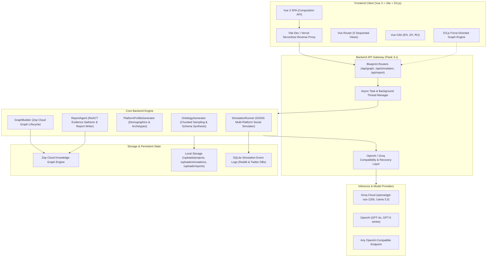

# 🏛️ Kritikos — Product & System Architecture Specification

> **Target Audience:** AI Models, System Architects, Technical Evaluators, and Core Contributors.  
> **Document Purpose:** Complete, self-contained architectural blueprint detailing the design, components, data flows, operational mechanisms, and resilience strategies of the Kritikos platform.

---

## 1. Executive Overview

**Kritikos** is an autonomous multi-agent simulation and market intelligence engine designed to stress-test startup and product concepts before capital or engineering resources are deployed.

Traditional idea validation relies on surveys, biased customer discovery interviews, or high-risk market launches. Kritikos eliminates these bottlenecks by automatically synthesizing a high-fidelity **digital simulation sandbox** directly from pitch decks, whitepapers, or business plans. 

Within this synthetic sandbox, dozens to hundreds of autonomous AI agents—representing diverse real-world stakeholder archetypes (target customers, enterprise decision-makers, skeptical technical architects, competitor executives, venture capital investors, and regulatory watchdogs)—debate, challenge assumptions, express authentic friction, and evolve social consensus across simulated social platforms (Twitter & Reddit sandboxes).

```
                 ┌────────────────────────────────────────────────────────┐
                 │                Pitch Materials / Idea Input            │
                 │              (PDF, DOCX, TXT, Markdown, Pitch)        │
                 └───────────────────────────┬────────────────────────────┘
                                             │
                                             ▼
                               ┌───────────────────────────┐
                               │  Step 1: Ontology Engine  │
                               │  - 10 Entity Types        │
                               │  - 6-10 Edge Types        │
                               └─────────────┬─────────────┘
                                             │
                                             ▼
                               ┌───────────────────────────┐
                               │  Step 2: GraphRAG Memory  │
                               │  - Zep Cloud Graph        │
                               │  - Episodes & Communities │
                               └─────────────┬─────────────┘
                                             │
                                             ▼
                               ┌───────────────────────────┐
                               │  Step 3: OASIS Swarm Prep │
                               │  - Demographics & MBTI    │
                               │  - Twitter & Reddit Specs │
                               └─────────────┬─────────────┘
                                             │
                                             ▼
                               ┌───────────────────────────┐
                               │  Step 4: Swarm Simulation │
                               │  - Multi-round Debate     │
                               │  - ReACT Report Synthesis │
                               │  - 0-100 Investment Score │
                               └─────────────┬─────────────┘
                                             │
                                             ▼
                               ┌───────────────────────────┐
                               │  Step 5: Deep Interaction │
                               │  - 1-on-1 Persona Chat    │
                               │  - Live Graph Explorer    │
                               │  - Community Surveys      │
                               └───────────────────────────┘
```

---

## 2. High-Level System Architecture

The platform is structured into a decoupled, modern client-server architecture:



---

## 3. The 5-Step Pipeline: Deep Dive

### Step 1: Knowledge Graph Ontology Generation
* **API Route:** `POST /api/graph/ontology/generate`
* **Service Module:** `backend/app/services/ontology_generator.py`
* **Mechanism:**
  1. **Document Ingestion:** Accepts PDF, DOCX, TXT, or Markdown documents. Extracts raw text via PyMuPDF (`pymupdf`/`fitz`).
  2. **Token-Safe Context Capping:** To prevent HTTP 413 (Payload Too Large) on rate-limited providers (e.g., Groq's 8,000 TPM limit), the input context is dynamically capped (`MAX_TEXT_LENGTH_FOR_LLM = 16000` chars). Long documents are split into representative chunks sampled across beginning, middle, and end.
  3. **Schema Design:** Prompts the LLM to design an ontology tailored to market adoption and stakeholder dynamics:
     - Exactly **10 Entity Types**: 8 domain-specific entities (e.g., `EnterpriseBuyer`, `SecurityAuditor`, `GrowthFundPartner`) plus 2 mandatory fallback entities (`Person`, `Organization`).
     - **6 to 10 Relationship Types**: Formatted in `UPPER_SNAKE_CASE` (e.g., `EVALUATES`, `COMPETES_WITH`, `WORKS_FOR`).
     - Attribute sanitization: Automatically cleans invalid characters, PascalCases entity names, and strips reserved system keywords (`uuid`, `group_id`, `graph_id`).

### Step 2: GraphRAG Knowledge Graph Build
* **API Route:** `POST /api/graph/build`
* **Service Module:** `backend/app/services/graph_builder.py` & `backend/app/services/zep_client.py`
* **Mechanism:**
  1. **Ontology Registration:** Compiles dynamic Pydantic models for the generated ontology and installs them onto **Zep Cloud**.
  2. **Episode Chunking:** Splits pitch documents into episodic text chunks with overlap and uploads them to Zep's Graph API.
  3. **Entity Extraction & Edge Synthesis:** Zep extracts entities, resolves co-references, detects node communities, and synthesizes temporal memory edges.
  4. **Progress Streaming:** Polled via `GET /api/graph/build/status` or streamed via SSE for real-time visualization on the frontend D3.js canvas.

### Step 3: Environment Setup & Persona Synthesis
* **API Route:** `POST /api/simulation/prepare`
* **Service Modules:** `backend/app/services/platform_profile_generator.py` & `zep_entity_reader.py`
* **Mechanism:**
  1. **Entity Ingestion:** Reads concrete nodes and edge topologies from Zep Cloud.
  2. **Persona Archetyping:** For each entity, synthesizes rich psychological and demographic profiles:
     - Name, handle, age, country, occupation, MBTI personality type.
     - Bio, tone of voice, professional skepticism/enthusiasm bias.
     - Target platform behaviors (Twitter character-limited punchy posts, Reddit long-form analytical threads).
  3. **Artifact Generation:** Stores outputs in `/uploads/simulations/{sim_id}`:
     - `reddit_profiles.json` (Structured JSON agent definitions).
     - `twitter_profiles.csv` (OASIS CSV platform format).
     - `simulation_config.json` (Peak active hours, hourly post rates, seed topics, initial posters).
     - `state.json` (Lifecycle state machine).

### Step 4: Autonomous Swarm Simulation & ReACT Report Synthesis
* **API Route:** `POST /api/simulation/start` & `POST /api/report/generate`
* **Service Modules:** `backend/app/services/simulation_runner.py` & `backend/app/services/report_agent.py`
* **Mechanism:**
  1. **OASIS Multi-Platform Simulation:**
     - Simulates multi-round stakeholder debates across isolated Reddit and Twitter digital sandboxes.
     - Tracks agent actions: post generation, comment trees, quote tweets, retweets, and upvotes stored in local SQLite databases (`reddit_simulation.db`, `twitter_simulation.db`).
  2. **ReACT Evidence Gathering:**
     - The `ReportAgent` plans a 3 to 4 chapter investment-grade report.
     - In an autonomous ReACT (Reasoning + Acting) loop, the agent invokes tools to retrieve authentic evidence:
       - `insight_forge`: Deep thematic graph retrieval combining global and local graph memory.
       - `panorama_search`: Wide-angle search capturing event progression and timeline consensus.
       - `quick_search`: Fast factual validation and direct metric lookup.
       - `interview_agents`: Direct 1-on-1 interviews with live simulated agents.
  3. **Evaluation Framework (0–100 Scoring):**
     - **Overall Idea Viability Score (0–100)** with definitive verdict (`[STRONG GO / INVEST]`, `[CONDITIONAL GO / PIVOT REQUIRED]`, `[NO-GO / HIGH RISK]`).
     - **Multi-Stakeholder Scorecard**: Customer demand, technical feasibility, investor/economic upside, regulatory compliance.
     - **Comprehensive SWOT Matrix & Competitive Moat**: Defensibility rating across network effects, switching costs, and technical barriers.
     - **Strategic Pivot Roadmap**: Concrete vectors for de-risking the venture.

### Step 5: Deep Interaction Workbench
* **API Route:** `POST /api/report/chat`, `GET /api/simulation/{id}/profiles/realtime`, `POST /api/simulation/interview/batch`
* **Frontend View:** `frontend/src/views/InteractionView.vue` & `frontend/src/components/Step5Interaction.vue`
* **Mechanism:**
  1. **Conversational Report Agent:** A persistent chat agent with full memory of the report, project graph, and simulation dynamics.
  2. **Direct Agent Interrogations:** The user can select any individual simulated stakeholder (e.g. an Enterprise Buyer or Senior Security Engineer) from a dropdown of active agents and ask tailored follow-up questions.
  3. **Community Survey Broadcast:** Send custom survey questions to the entire swarm to calculate statistical consensus and sentiment distributions.
  4. **Dynamic Knowledge Graph Explorer:** Full force-directed D3.js visualization allowing interactive node filtering, connection inspection, and community cluster analysis.

---

## 4. Key Architectural & Resilience Innovations

### 4.1 Token-per-Minute (TPM) Payload Capping
* **Challenge:** Large pitch decks and business plans easily reach 25,000–50,000+ characters (~8,000–12,000 tokens), causing rate-limited providers (e.g., Groq's 8,000 TPM limit on `openai/gpt-oss-120b`) to reject requests with `HTTP 413: Request too large for model`.
* **Solution:** [`backend/app/services/ontology_generator.py`](file:///c:/Users/ASUS/OneDrive/Desktop/MiroFish-main/backend/app/services/ontology_generator.py) caps input text at `16,000` characters. When exceeding this budget, `_select_representative_chunks` equidistantly samples chunks across the document's beginning, middle, and end, ensuring holistic domain coverage without token overflow.

### 4.2 Autonomous Groq `tool_use_failed` Recovery
* **Challenge:** When using prompt-based tool execution, open-weight models (like Llama-3 / GPT-OSS-120B on Groq) can output internal tool-calling tokens. Groq detects these tokens without a matching API `tools=[...]` array and rejects the generation with:
  `400 Bad Request: 'Tool choice is none, but model called a tool' (code: 'tool_use_failed')`.
* **Solution:** [`backend/app/utils/openai_chat_compat.py`](file:///c:/Users/ASUS/OneDrive/Desktop/MiroFish-main/backend/app/utils/openai_chat_compat.py) intercepts this specific error, extracts Groq's `failed_generation` payload field, converts it into standard `<tool_call>` XML syntax, and returns a synthetic completion. The ReACT loop continues seamlessly without halting.

### 4.3 Intelligent Tool Aliasing & Flexible Parameter Normalization
* **Challenge:** LLMs often hallucinate alternate tool names (e.g., calling `simulation_query` or `query_simulation` instead of `insight_forge`), or pass varied parameter formats (e.g., `{"questions": [...]}` instead of `{"interview_topic": "..."}`).
* **Solution:** `ReportAgent._execute_tool` registers alias redirects for `simulation_query` -> `insight_forge`, and dynamically parses questions lists, topics, and agent arrays to maximize tool-calling adherence.

### 4.4 Self-Healing State & Detached Session Resilience
* **Challenge:** If a user reloads a report whose local simulation folder was cleared or created in an earlier session, API endpoints could return `404 Simulation not found`.
* **Solution:** Both [`report.py`](file:///c:/Users/ASUS/OneDrive/Desktop/MiroFish-main/backend/app/api/report.py) and [`simulation.py`](file:///c:/Users/ASUS/OneDrive/Desktop/MiroFish-main/backend/app/api/simulation.py) implement self-healing fallbacks:
  - `/api/report/chat` recovers `graph_id` and `simulation_requirement` directly from `ReportManager` metadata.
  - `get_simulation_profiles_realtime` automatically recovers existing agent profiles from active simulation environments, ensuring Step 5 never defaults to 0 available agents.

---

## 5. Technology Stack Summary

| Layer | Technologies | Rationale |
| :--- | :--- | :--- |
| **Frontend Framework** | **Vue 3** (Composition API, `<script setup>`) | Clean reactive architecture, modular component structure |
| **Build Tool** | **Vite 7** | Ultra-fast HMR and bundle compilation |
| **Data Visualization** | **D3.js (v7)** Force-Directed Graphs | Hardware-accelerated dynamic graph physics and node layouts |
| **Styling & Design** | **Pure Vanilla CSS** | Custom modern aesthetic: glassmorphism, dark/light contrast, micro-animations |
| **Internationalization** | **Vue-I18n (v11)** | Real-time multi-language switching (English, Chinese, Russian) |
| **Backend Framework** | **Python 3.11+ / Flask 3.x** | Mature asynchronous background tasks, Python AI ecosystem |
| **Knowledge Graph** | **Zep Cloud Graph API** | Entity extraction, temporal memory, community summarization |
| **Document Processing** | **PyMuPDF (`pymupdf`/`fitz`)** | Blazing-fast PDF, DOCX, and TXT text extraction |
| **Social Simulation** | **OASIS Social Swarm Engine** | Multi-platform Reddit and Twitter agent sandbox with SQLite persistence |
| **LLM Gateway** | **OpenAI Python SDK + Compat Layer** | Model-agnostic integration: Groq, OpenAI, DeepSeek, vLLM, Ollama |

---

## 6. Directory Structure & Key Files

```
Kritikos/
├── backend/                        # Backend Flask Engine
│   ├── app/
│   │   ├── api/                    # HTTP Blueprints & REST Endpoints
│   │   │   ├── graph.py            # Step 1 & 2: Ontology & Graph endpoints
│   │   │   ├── simulation.py       # Step 3 & 4: OASIS agent simulation endpoints
│   │   │   └── report.py           # Step 4 & 5: Report generation & interaction chat
│   │   ├── services/               # Core Application Services
│   │   │   ├── ontology_generator.py # Token-safe ontology synthesizer
│   │   │   ├── graph_builder.py    # Zep Cloud graph lifecycle & memory manager
│   │   │   ├── platform_profile_generator.py # Archetype & persona generation
│   │   │   ├── simulation_runner.py# OASIS Twitter/Reddit simulator coordinator
│   │   │   ├── report_agent.py     # ReACT evidence gatherer & report synthesis
│   │   │   ├── report_manager.py   # Persistent report storage & metadata
│   │   │   └── zep_tools.py        # Graph querying tools for LLM agent
│   │   └── utils/                  # Shared Utilities & Wrappers
│   │       ├── llm_client.py       # OpenAI-compatible LLM client
│   │       └── openai_chat_compat.py # Groq TPM & tool_use_failed resilience layer
│   ├── run.py                      # Flask Application Entry Point (Port 5001)
│   ├── pyproject.toml              # Python Dependency Manifest
│   └── tests/                      # Automated Test Suite (129+ unit & integration tests)
├── frontend/                       # Frontend Vue 3 SPA
│   ├── src/
│   │   ├── views/                  # Primary Workflow Views
│   │   │   ├── Home.vue            # Project onboarding & pitch submission
│   │   │   ├── MainView.vue        # Step 1 & 2: Ontology & Graph build workbench
│   │   │   ├── SimulationView.vue  # Step 3: Swarm environment & persona setup
│   │   │   ├── SimulationRunView.vue # Step 4: Live simulation stream
│   │   │   ├── ReportView.vue      # Step 4: Idea validation report display
│   │   │   └── InteractionView.vue # Step 5: Deep interaction workbench
│   │   ├── components/             # Reusable UI Components
│   │   │   ├── GraphPanel.vue      # D3.js force-directed knowledge graph
│   │   │   ├── Step5Interaction.vue# 1-on-1 agent chat & survey broadcast
│   │   │   └── Step4Report.vue     # Markdown report renderer
│   │   ├── api/                    # Axios API client services
│   │   └── router/                 # Vue Router configurations
│   ├── vite.config.js              # Vite server & /api reverse proxy configuration
│   └── package.json                # Frontend NPM dependencies
├── locales/                        # Internationalization Dictionaries (en.json, zh.json, ru.json)
├── static/                         # Static Assets & Screenshots
├── .env.example                    # Environment variable template
├── vercel.json                     # Vercel deployment & rewrite configuration
└── README.md                       # Repository introduction
```

---

## 7. Complete API Reference

| Endpoint | Method | Pipeline Step | Description |
| :--- | :--- | :--- | :--- |
| `/api/graph/ontology/generate` | `POST` | Step 1 | Ingests pitch documents, analyzes text, and generates 10 entity and relationship types |
| `/api/graph/build` | `POST` | Step 2 | Installs ontology in Zep Cloud and constructs GraphRAG episodic memory |
| `/api/graph/build/status` | `GET` | Step 2 | Streams or polls real-time graph building progress |
| `/api/graph/data/<graph_id>` | `GET` | Step 2 | Retrieves node and edge graph data for D3.js rendering |
| `/api/simulation/prepare` | `POST` | Step 3 | Reads entities from graph and generates synthetic agent personas and configs |
| `/api/simulation/<id>/profiles/realtime` | `GET` | Step 3 & 5 | Retrieves list of generated agents and persona bios |
| `/api/simulation/start` | `POST` | Step 4 | Spawns autonomous OASIS multi-agent social debate |
| `/api/simulation/<id>/status` | `GET` | Step 4 | Polls live simulation progress, current round, and agent activities |
| `/api/report/generate` | `POST` | Step 4 | Launches ReACT `ReportAgent` to synthesize Idea Validation Report |
| `/api/report/<id>` | `GET` | Step 4 & 5 | Retrieves completed report markdown, outline, scores, and metadata |
| `/api/report/chat` | `POST` | Step 5 | Conversational Q&A with the Report Agent backed by graph memory |
| `/api/simulation/interview/batch`| `POST` | Step 5 | Conducts direct 1-on-1 interviews with specific simulated agent personas |

---

## 8. Security, Privacy & Operational Guardrails

1. **Zero Secret Leaks:**
   - All credentials (`LLM_API_KEY`, `ZEP_API_KEY`) reside exclusively in server-side environment variables (`.env`).
   - The frontend communicates only with the local reverse proxy (`/api`); no third-party API keys are ever bundled into client artifacts.
2. **Deterministic Fallbacks:**
   - All critical LLM generations incorporate JSON schemas and programmatic repair rules to eliminate malformed outputs.
3. **Strict English / Rebranding Integrity:**
   - All prompts, system messages, and default outputs are strictly standardized to clear, professional English under the **Kritikos** brand.
4. **Deployability:**
   - **Frontend:** Fully production-optimized and deployable via Vercel (`vercel.json`).
   - **Backend:** Deployable via Docker (`Dockerfile`, `docker-compose.yml`), Render, Fly.io, or run locally via `python run.py`.

---

*Authored for the Kritikos Project Architecture Specification. Maintained at: [https://github.com/divyanshshah01/Kritikos](https://github.com/divyanshshah01/Kritikos)*
