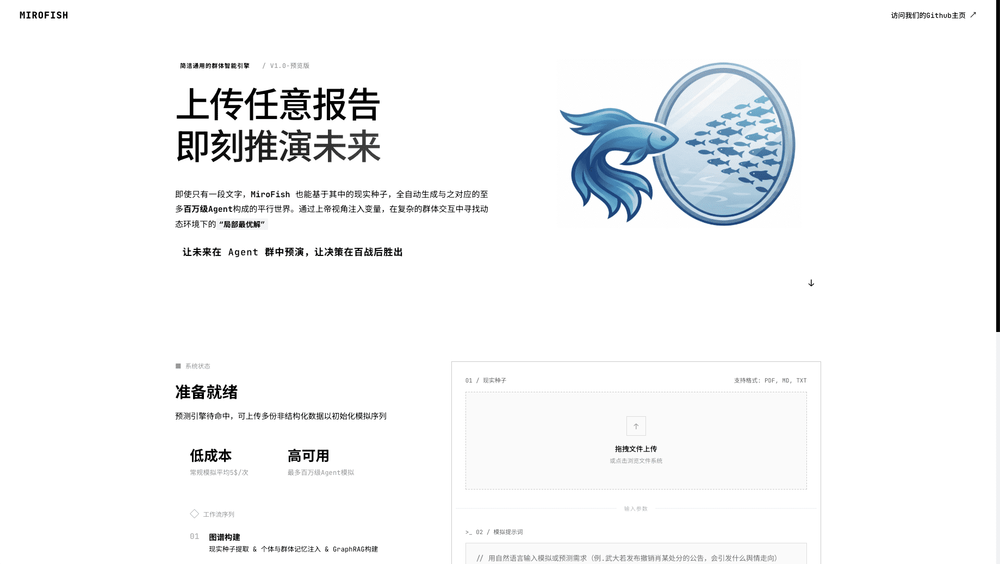
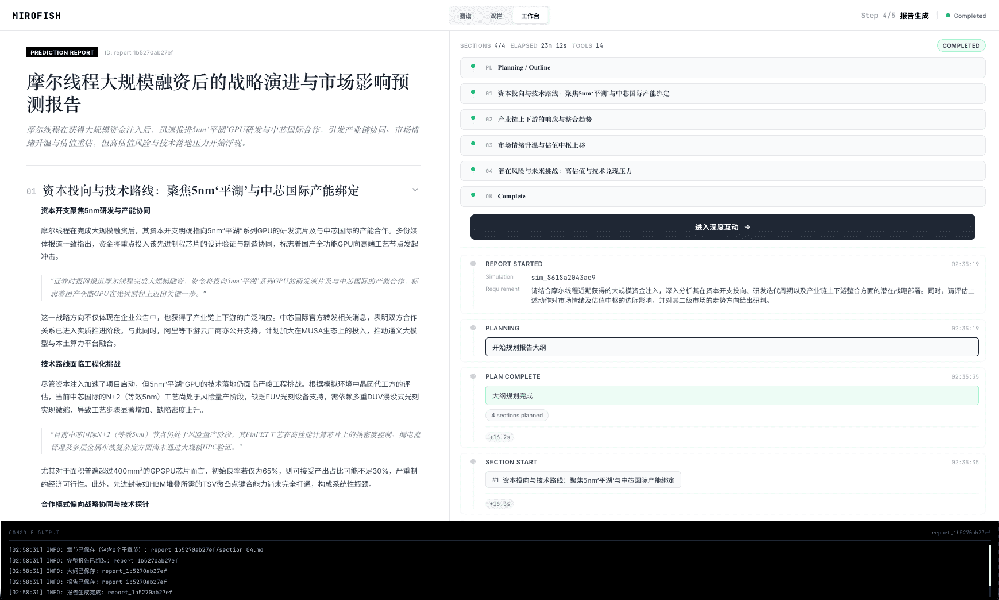

<div align="center">


# Kritikos

### Autonomous Multi-Agent Startup & Product Idea Validation Engine

[](https://kritikos.vercel.app)
[](./LICENSE)
[](https://www.python.org/)
[](https://vuejs.org/)
[](https://vitejs.dev/)

</div>

---

## ⚡ Overview

**Kritikos** is an autonomous multi-agent simulation and market intelligence platform designed for startup founders, product managers, and venture investors.

Instead of testing unproven hypotheses directly on real markets or spending months on customer interviews, Kritikos builds a high-fidelity digital sandbox from your pitch decks, market reports, or business ideas. Within this parallel digital environment, hundreds of autonomous AI agents—representing realistic customer archetypes, investors, competitors, and domain specialists—interact, discuss, critique, and evolve in real time.

> **Input**: Upload startup materials (pitch decks, business plans, whitepapers, or feature ideas) and define your validation questions.  
> **Output**: Comprehensive executive validation reports, market fit risk scores, synthetic focus groups, and live agent interviews.

---

## 📸 Screenshots

<div align="center">
<table>
<tr>
<td></td>
<td></td>
</tr>
<tr>
<td></td>
<td></td>
</tr>
<tr>
<td></td>
<td></td>
</tr>
</table>
</div>

---

## 🔄 Five-Stage Validation Workflow

1. **Knowledge Graph Construction**:
   - Parses pitch documents and extracts seed concepts.
   - Structures market domain ontology and populates persistent graph memory using Zep Cloud.

2. **Environment & Persona Setup**:
   - Synthesizes diverse persona archetypes: Early Adopters, Enterprise Decision-Makers, Skeptics, and Industry Competitors.
   - Injects behavioral parameters, activity schedules, and social graph edges.

3. **Autonomous Swarm Simulation**:
   - Simulates multi-channel market reactions across parallel Reddit and Twitter digital sandboxes.
   - Dynamic temporal memory graph updates track evolving consumer sentiment round-by-round.

4. **Strategic Report Generation**:
   - ReportAgent autonomously gathers evidence, queries historical interactions, and calculates viability scores.
   - Generates actionable GTM recommendations, risk analyses, and pricing feedback.

5. **Deep Persona Interaction**:
   - Conduct 1-on-1 interviews with any synthetic customer or investor agent to probe their objections and preferences.

---

## 🚀 Quick Start

### Prerequisites

| Tool | Version | Description |
|------|---------|-------------|
| **Node.js** | ≥ 18.0.0 | Frontend runtime & package manager |
| **Python** | 3.11 or 3.12 | Backend engine runtime |
| **uv** | Latest | Fast Python package manager (`pip install uv`) |

---

### 1. Environment Setup

Copy `.env.example` to `.env`:

```bash
cp .env.example .env
```

Configure your credentials in `.env`:

```env
# LLM Configuration (supports any OpenAI-compatible API)
LLM_API_KEY=your_llm_api_key
LLM_BASE_URL=https://api.openai.com/v1
LLM_MODEL_NAME=gpt-4o

# Zep Cloud Graph Memory Configuration
# Free monthly tier: https://app.getzep.com/
ZEP_API_KEY=your_zep_api_key
```

---

### 2. Install Dependencies

```bash
# Install all dependencies (Frontend + Backend)
npm run setup:all
```

Or install individually:

```bash
# Install frontend
npm run setup

# Install backend with uv
npm run setup:backend
```

---

### 3. Run Locally

```bash
# Start both frontend and backend concurrently
npm run dev
```

- **Frontend Application**: `http://localhost:3000`
- **Backend API**: `http://localhost:5001`

---

## 🌐 Production Deployment

- **Frontend**: Hosted on [Vercel](https://kritikos.vercel.app) with automated SPA routing defined in `vercel.json`.
- **Backend**: Container-ready for deployment on Render, Railway, Fly.io, or any Linux server using `Dockerfile` or `docker-compose.yml`.

---

## 📄 License & Credits

- Licensed under **AGPL-3.0**.
- Multi-agent simulation framework powered by **[OASIS (Open Agent Social Interaction Simulations)](https://github.com/camel-ai/oasis)**.
